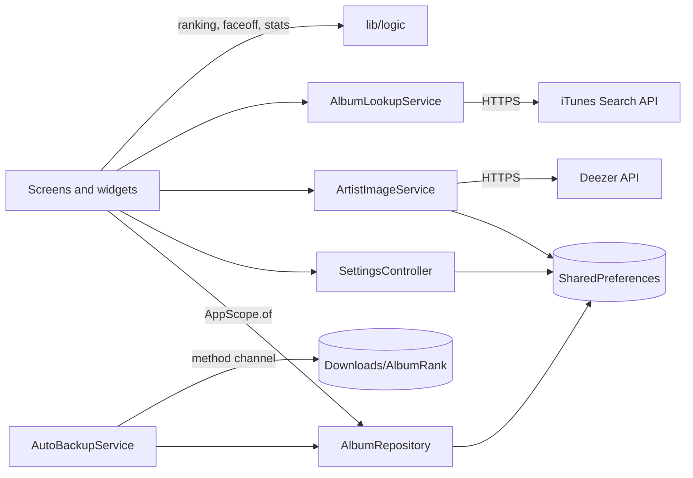

# Architecture

AlbumRank is a single Flutter app with no backend. All data lives on the device; the only network calls are to two free public APIs for album info and band photos.

## Layout

```
lib/
├── main.dart                 App entry; builds services and the root widget
├── app_scope.dart            InheritedWidget that hands services to the UI
├── models/
│   └── album.dart            Album data class, JSON, rating rules
├── data/
│   ├── album_repository.dart Master list: CRUD, name merging, import/export, persistence
│   └── settings_controller.dart  User preferences (theme, sort, toggles)
├── logic/                    Pure functions, no Flutter UI
│   ├── ranking.dart          Grouping, averages, ties, quality coefficient
│   ├── faceoff.dart          Face-off pools, pairing and rating suggestions
│   ├── year_chart.dart       Ratings-by-year timeline
│   └── stats.dart            Library totals and distributions
├── services/                 Network and platform access
│   ├── album_lookup_service.dart   iTunes Search API
│   ├── artist_image_service.dart   Deezer artist photos + cache
│   └── auto_backup_service.dart    Weekly backup to Downloads
├── theme/
│   ├── app_theme.dart        Material 3 light/dark themes
│   └── rating_colors.dart    Red→blue rating color scale
└── ui/                       Screens and widgets
    ├── home_shell.dart       Bottom navigation (5 tabs)
    ├── albums_screen.dart, album_edit_screen.dart
    ├── rankings_screen.dart, group_detail_screen.dart
    ├── faceoff_screen.dart (setup), faceoff_arena.dart (animated match-ups)
    ├── stats_screen.dart, settings_screen.dart
    ├── share_card_screen.dart, duplicate_names_screen.dart
    ├── artist_image_picker.dart, artist_images_screen.dart
    └── widgets/              Album tile, rating controls, crowns, charts, backdrops
```

Android-specific code is in `android/app/src/main/kotlin/com/ncpawlak/albumrank/MainActivity.kt`. It exposes one method channel, `albumrank/backup`, which writes backup files to the public Downloads folder through MediaStore.

## State management

There's no state-management package. The app uses plain Flutter:

- `AlbumRepository`, `SettingsController`, `ArtistImageService` and `AutoBackupService` are `ChangeNotifier`s.
- `AppScope` (an `InheritedWidget`) makes them available anywhere via `AppScope.of(context)`.
- Screens rebuild with `ListenableBuilder` when a notifier changes.
- Everything derived (rankings, stats, charts) is recalculated from the album list on rebuild. The list is small (hundreds of albums), so this is fast and nothing can go stale.



## External services

Both APIs are free and need no key.

### iTunes Search API (`AlbumLookupService`)

- `GET https://itunes.apple.com/search?term=…&media=music&entity=album&limit=8`
- Maps `collectionName`, `artistName`, `releaseDate` (year), `primaryGenreName` and `artworkUrl100` (upgraded to 600×600) into a suggestion.
- The album's iTunes ID is saved as `externalId: "itunes:<id>"`.
- 5-second timeout. Failures just mean no suggestions; manual entry always works.

### Deezer API (`ArtistImageService`)

- `GET https://api.deezer.com/search/artist?q=…&limit=10`
- Automatic match: a result whose name equals the artist's after removing case, punctuation and spaces, and after folding stylized letters (`KoЯn` → `korn`, `Mötley Crüe` → `motley crue`). If several match, the one with the most Deezer fans wins.
- Artists without a real photo (Deezer's silhouette, a URL containing `/artist//`) count as "no photo".
- Each artist is looked up **once**. The result (a photo URL, or empty for "none found") is cached in SharedPreferences. Network errors aren't cached, so they're retried next time.
- Concurrent lookups for the same artist share one request.
- The picker sheet (`artist_image_picker.dart`) runs free-text searches, sorted by fan count, and saves the user's choice with `setImage`.

Images load through `Image.network`, which caches them in memory. A failed image simply doesn't appear.

## Notable UI pieces

- **Backdrop** (`widgets/backdrop.dart`): paints the background image at 20–32% opacity with a light blur and a gradient fade into the surface color, so text stays readable. `CoverCollage` builds an oversized, tilted 4-column grid that cycles through up to 12 of the group's top covers.
- **Face-off arena** (`faceoff_arena.dart`): one `AnimationController` drives the fly-in, impact flash, reveal and exit. The background is two photos clipped by a 45° diagonal (`_DiagonalClipper`) with a glowing seam (`_SeamPainter`); the winner's half brightens and the loser's dims.
- **Year chart** (`widgets/year_chart.dart`): a `CustomPainter` used on the Stats tab and on group detail screens.
- **Share card** (`share_card_screen.dart`): renders a widget to PNG with `RepaintBoundary` and shares it with `share_plus`.

## Testing

Tests live in `test/` and use `flutter_test`. HTTP is faked with `package:http/testing.dart`'s `MockClient`, and SharedPreferences with `setMockInitialValues`. Logic files have unit tests; screens have widget tests that drive the real app (`AlbumRankerApp`) with fake services.
